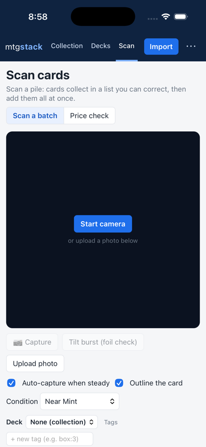

# The installed app (iOS and Android)

The app is the same web app as the GitHub Pages site, packaged with [Capacitor](https://capacitorjs.com) 8. The Python
engine, the scanner and the recognition model are inside the app; your collection is stored in the app's own data on
the device. Only the card database (about 47 MB) is downloaded, from the Pages site, on first use and when it updates.

- Projects: `frontend/android`, `frontend/ios` (generated by Capacitor, committed), config `frontend/capacitor.config.json`.
- App id: `io.github.altairajit.mtgstack`. It is permanent once an app is created in App Store Connect or Google Play,
  so change it (capacitor.config.json, `android/app/build.gradle`, the Xcode project) before the first upload if wanted.
- Web assets: `python scripts/build_pages.py --out frontend/native-www --base / --native --model model --data-url <site>/data/`
  then `npx cap sync` in `frontend/`. `--native` builds the variant that works without a service worker
  (`frontend/src/local/boot.ts`): iOS app web views have none.
- CI: `.github/workflows/app.yml` builds a debug Android APK and compiles the iOS app on every push that touches the app.

## Testing in the iOS simulator (no Mac needed)

Every run of the workflow installs the app in an iPhone simulator on GitHub's Mac runner and lets it tour itself
(`frontend/src/local/selftest.ts`, active only when the bundle contains `selftest.json`, which the job adds). The job
log lists what the app reported (screen and safe area, storage available, card database, a detect and two scans of a
sample card picture, whether the recognition model loaded) and the `ios-simulator` artifact has screenshots and the
full log. Check it before uploading to TestFlight. The simulator has no real camera: the live camera is only tested on
a phone.

## Android

Download `mtgstack-android-debug` from the latest run of the "Installed app" workflow (Actions tab), unzip it, and open
`app-debug.apk` on the phone (allow installing from the browser or file manager when asked). A debug build is fine for
your own phone. A Play Store release needs a signed release build and a Google Play developer account ($25 once).

## iPhone (TestFlight)

Needs an Apple Developer Program membership ($99 a year). No Mac is needed: GitHub builds and uploads.

1. Enrol at https://developer.apple.com/programs/ (approval can take a day or two).
2. In App Store Connect (https://appstoreconnect.apple.com): Apps -> + -> New App, platform iOS, bundle ID
   `io.github.altairajit.mtgstack` (register it under Certificates, Identifiers & Profiles first if it is not offered).
3. Users and Access -> Integrations -> App Store Connect API -> generate a key with the "Admin" role
   (Xcode signs the upload with a cloud-managed distribution certificate, which an "App Manager" key may not create: the
   export then fails with "Cloud signing permission error"). Note the
   Key ID and the Issuer ID and download the `.p8` file (it can only be downloaded once).
4. In the GitHub repository: Settings -> Secrets and variables -> Actions.
   - Secrets: `APPSTORE_KEY_ID`, `APPSTORE_ISSUER_ID`, `APPSTORE_PRIVATE_KEY` (the whole contents of the `.p8` file).
   - Variable: `APPLE_TEAM_ID` (Membership details on developer.apple.com).
5. Actions -> "Installed app (Android + iOS)" -> Run workflow -> tick "Upload the iOS app to TestFlight".
6. When the build finishes processing in App Store Connect, add yourself as an internal tester under TestFlight and
   install it with the TestFlight app.

The upload job works (first build uploaded 13 Nov 2026, with an Admin team key). Its first step checks the key
against Apple and says what is wrong with it in a few seconds, before any build time is spent.

### Signing certificates

Each upload runs on a fresh GitHub machine, so Xcode creates a new development certificate every time. An account holds
only a few; when it is full the archive fails with "Your account has reached the maximum number of certificates". The
upload job now removes the certificate it created when it finishes. To look or clean up by hand: Actions -> Run
workflow -> "Apple signing certificates" -> `list` or `revoke-ci` (only development certificates named "Created via
API" are ever revoked; `scripts/appstore_certs.py`).

## Not done yet

- The app has not been run on a real iPhone or Android phone, only built. The web variant it packages was checked in a
  desktop browser.
- The CSV export uses a browser download, which app web views do not offer: it needs a share sheet.
- Your collection lives in the web view's storage inside the app. A copy as a plain file (for backups and, later,
  for linking to an account) is the next step.
- App icon and splash screen are Capacitor's defaults.
